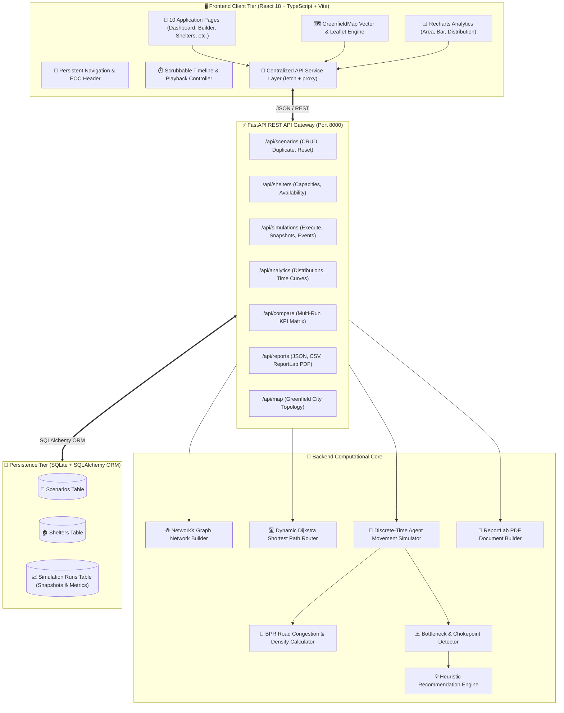
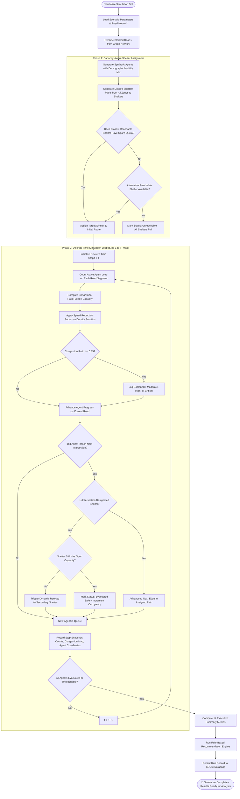
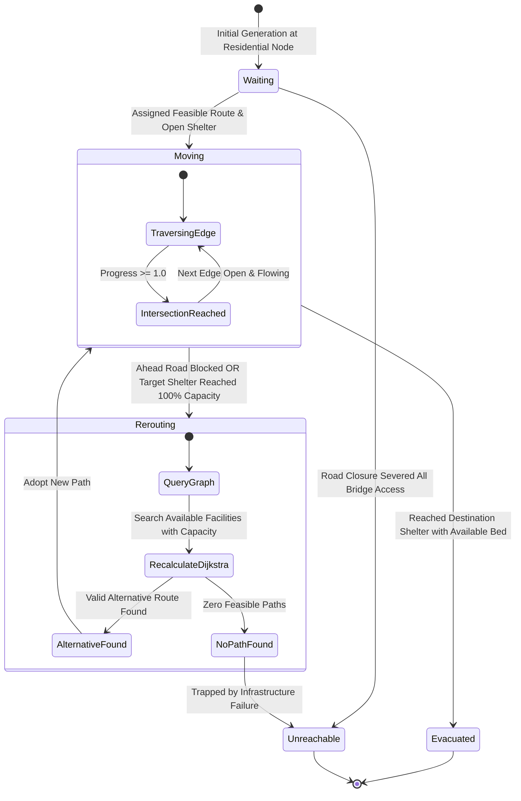
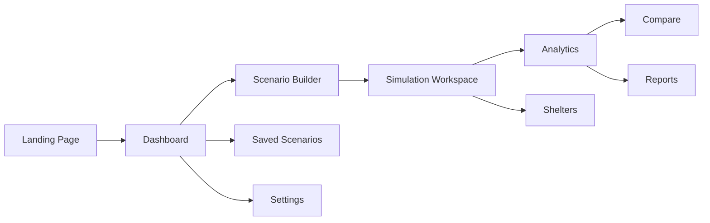

# SurakshaSathi — Intelligent Disaster Evacuation Planning & Simulation Platform

<div align="center">


**Simulate Today. Save Lives Tomorrow.**  
*An intelligent, 100% software-based digital environment for testing, analyzing, and optimizing municipal disaster evacuation strategies before emergencies strike.*

[Explore Features](#-key-features--capabilities) • [System Architecture](#-system-architecture) • [Simulation Workflow](#-simulation-engine-lifecycle--flowchart) • [Network Topography](#-greenfield-city-topography--network-model) • [Getting Started](#-installation--startup-guide)

</div>

---

## 📌 Executive Overview

During catastrophic floods, wildfires, and seismic disruptions, emergency planners face three compounding crises:
1. **Critical Corridor Gridlock:** Mass simultaneous departures overwhelm primary arterial bridges and highways.
2. **Dynamic Inundation & Severed Topology:** Rising floodwaters or fire fronts block critical roads, isolating entire neighborhoods.
3. **Shelter Asymmetry & Capacity Breaches:** Evacuees converge on geographically proximal shelters, creating dangerous overcrowding while secondary facilities remain vacant.

**SurakshaSathi** resolves these operational challenges through a **software-only, agent-based simulation and graph-optimization platform**. Planners can model hypothetical disaster scenarios, simulate population movement through road networks toward designated shelters, automatically detect bottlenecks, evaluate shelter capacities, compare evacuation strategies, and generate audit-ready reports.

### 🛡️ Mandatory Planning Constraints Adhered To
* **100% Software-Based:** Requires **zero hardware sensors, no CCTV feeds, no image recognition, no IoT devices, no drone integrations, and no live GPS tracking of real citizens**.
* **Self-Contained Demonstration:** Uses a calibrated fictional town named **Greenfield City** featuring 20 nodes, 32 road segments, 4 regional shelters, and a dynamic river hazard zone.
* **Deterministic & Verifiable:** Controlled via fixed random seeds ($RNG = 42$), guaranteeing repeatable and fair comparisons between baseline and optimized strategies.
* **Open Source & Local:** Operates entirely locally using SQLite, NetworkX, FastAPI, and Vite without paid external APIs.

---

## 🏗️ System Architecture

EvacuSafe employs a modular, decoupled full-stack architecture designed for high-performance simulation and intuitive mission-control visualization:



---

## 🔄 Simulation Engine Lifecycle & Flowchart

The simulation engine operates on a discrete-time step model ($1 \text{ step} = 30 \text{ seconds}$ of simulated time). The end-to-end lifecycle follows this structured execution sequence:



---

## 🤖 Agent Decision-Making & Dynamic Rerouting

Every virtual evacuee operates as an autonomous graph-traversing agent. The flowchart below details how agents make dynamic routing decisions in response to road congestion and filled shelters:



---

## 🗺️ Greenfield City Topography & Network Model

Greenfield City is partitioned by the **Greenfield River**, which flows diagonally through the center of town. Three strategic crossings connect the western residential districts with eastern industrial centers and safe havens:

```
                          [N17] North High School Shelter (S1)
                                      |
                             (R-15) [Capacity: 220]
                                      |
     [N2] Hillside Estates ------ [N11] North River Bridge ------ [N3] Oak Valley
              \                         |                          /         \
               \ (R-2)             (R-11) Bridge Link         (R-17)     (R-18)
                \                       |                      /             \
  [N1] West Riverside -- [N8] West Junction -- [N9] Central Plaza -- [N14] Metro Junction -- [N18] East Sports Complex (S2)
            |                   |                      |                   |                  [Capacity: 280]
          (R-29)              (R-9)                  (R-13)              (R-19)
            |                   |                      |                   |
  [N4] Sunset Heights -- [N15] Highway 101 --- [N10] Central Bridge -- [N13] Industrial Hub
            |            Interchange             (R-10) [HAZARD PRONE]     |
          (R-5)                 |                      |                 (R-21)
            |                 (R-26)                 (R-12)                |
  [N20] West Valley Arena       |                      |                 [N16] Valley Bypass Crossing
    (S4) [Capacity: 180]  [N5] Pinehurst --------- [N12] South Crossing    |           \
                                \                      |                 (R-25)        (R-23)
                                 \---- (R-7) --------- [N7] South Park ---/              \
                                                               |                          |
                                                            (R-24)                        |
                                                               |                          |
                                                 [N19] South Medical Evacuation Base (S3) -/
                                                           [Capacity: 150]
```

### 📍 Road Nodes Specification

| Node ID | Designation / Name | Node Classification | Position $(X, Y)$ | Geographic Lat / Lng | Population Weight |
|:---:|:---|:---|:---:|:---:|:---:|
| `N1` | West Riverside | Residential | $(120, 210)$ | $45.4350^{\circ}\text{N}, -75.7588^{\circ}\text{W}$ | $16\%$ |
| `N2` | Hillside Estates | Residential | $(260, 100)$ | $45.4515^{\circ}\text{N}, -75.7280^{\circ}\text{W}$ | $14\%$ |
| `N3` | Oak Valley | Residential | $(560, 120)$ | $45.4485^{\circ}\text{N}, -75.6620^{\circ}\text{W}$ | $15\%$ |
| `N4` | Sunset Heights | Residential | $(100, 380)$ | $45.4095^{\circ}\text{N}, -75.7632^{\circ}\text{W}$ | $12\%$ |
| `N5` | Pinehurst District | Residential | $(240, 480)$ | $45.3945^{\circ}\text{N}, -75.7324^{\circ}\text{W}$ | $13\%$ |
| `N6` | Old River Town | Residential | $(350, 280)$ | $45.4245^{\circ}\text{N}, -75.7082^{\circ}\text{W}$ | $15\%$ |
| `N7` | South Park District | Residential | $(520, 460)$ | $45.3975^{\circ}\text{N}, -75.6708^{\circ}\text{W}$ | $15\%$ |
| `N8` | West Junction | Major Intersection | $(220, 220)$ | $45.4335^{\circ}\text{N}, -75.7368^{\circ}\text{W}$ | Transit Only |
| `N9` | Downtown Central Plaza | Major Intersection | $(380, 180)$ | $45.4395^{\circ}\text{N}, -75.7016^{\circ}\text{W}$ | Transit Only |
| `N10` | Central River Bridge (South) | River Crossing | $(420, 290)$ | $45.4230^{\circ}\text{N}, -75.6928^{\circ}\text{W}$ | Transit Only |
| `N11` | North River Bridge | River Crossing | $(440, 90)$ | $45.4530^{\circ}\text{N}, -75.6884^{\circ}\text{W}$ | Transit Only |
| `N12` | South River Crossing | River Crossing | $(420, 430)$ | $45.4020^{\circ}\text{N}, -75.6928^{\circ}\text{W}$ | Transit Only |
| `N13` | East Industrial Hub | Commercial Intersection | $(620, 260)$ | $45.4275^{\circ}\text{N}, -75.6488^{\circ}\text{W}$ | Transit Only |
| `N14` | Metro Transit Junction | Major Intersection | $(480, 220)$ | $45.4335^{\circ}\text{N}, -75.6796^{\circ}\text{W}$ | Transit Only |
| `N15` | Highway 101 Interchange | Highway Junction | $(280, 360)$ | $45.4125^{\circ}\text{N}, -75.7236^{\circ}\text{W}$ | Transit Only |
| `N16` | Valley Bypass Crossing | Perimeter Crossing | $(580, 370)$ | $45.4110^{\circ}\text{N}, -75.6576^{\circ}\text{W}$ | Transit Only |
| `N17` | North High School Shelter (`S1`) | Evacuation Safe Haven | $(480, 40)$ | $45.4605^{\circ}\text{N}, -75.6796^{\circ}\text{W}$ | Safe Haven (220 beds) |
| `N18` | East Regional Sports Complex (`S2`) | Evacuation Safe Haven | $(710, 170)$ | $45.4410^{\circ}\text{N}, -75.6290^{\circ}\text{W}$ | Safe Haven (280 beds) |
| `N19` | South Medical Evacuation Base (`S3`) | Evacuation Safe Haven | $(640, 510)$ | $45.3900^{\circ}\text{N}, -75.6444^{\circ}\text{W}$ | Safe Haven (150 beds) |
| `N20` | West Valley Community Arena (`S4`) | Evacuation Safe Haven | $(60, 480)$ | $45.3945^{\circ}\text{N}, -75.7720^{\circ}\text{W}$ | Safe Haven (180 beds) |

---

## 📐 Mathematical Formulations

### 1. Dynamic Route Travel Cost
The cost function for an edge $e = (u, v)$ balances physical distance, nominal speed, dynamic congestion penalty, and hazard risk:

$$\text{Cost}(e) = \text{Time}_{\text{base}}(e) \cdot \left[1 + \alpha \cdot \left(\frac{\text{Load}(e)}{\text{Capacity}(e)}\right)^\beta\right] + \text{Hazard Penalty}(e)$$

Where:
- $\text{Time}_{\text{base}}(e) = \frac{\text{Length}(e)}{v_{\text{base}}(e) / 3.6}$ (base free-flow travel time in seconds)
- $\alpha = 2.2$ (congestion penalty sensitivity exponent)
- $\beta = 2.0$ (polynomial congestion curve)
- $\text{Hazard Penalty}(e) = \text{Time}_{\text{base}}(e) \cdot (\text{Hazard Exposure}(e) \times 1.5)$
- *If $e \in \text{BlockedRoads}$, then $\text{Cost}(e) = \infty$ (omitted from the NetworkX directed graph).*

### 2. Speed Reduction Under Congestion
Agent movement speed across an edge diminishes as vehicle density increases according to a calibrated Bureau of Public Roads (BPR) formulation:

$$v_{\text{eff}}(e) = v_{\text{nominal}} \cdot \max\left(0.18, \, 1.0 - 0.70 \cdot \min\left(2.0, \, \frac{\text{Load}(e)}{\text{Capacity}(e)}\right)\right)$$

### 3. Bottleneck Stress Ratio
A road segment is flagged as an active bottleneck when demand exceeds design threshold:

$$\text{Stress Ratio} = \frac{\text{Simulated Load}(e)}{\text{Configured Capacity}(e)}$$

$$\text{Category} = \begin{cases}
\text{Normal} & \text{Stress} < 0.85 \\
\text{Moderate} & 0.85 \le \text{Stress} < 1.00 \\
\text{High} & 1.00 \le \text{Stress} < 1.30 \\
\text{Critical} & \text{Stress} \ge 1.30
\end{cases}$$

### 4. Multi-Scenario Balanced Performance Score
The strategy comparison engine evaluates evacuation drills using an objective weighted composite score ($0 \text{ to } 100$):

$$\text{Score} = (\text{Rate} \times 0.40) + (\text{TimeScore} \times 0.25) + (\text{BottleneckScore} \times 0.20) + (\text{CongestionScore} \times 0.15)$$

Where:
- $\text{Rate} = \frac{\text{Evacuated}}{\text{Population}} \times 100$
- $\text{TimeScore} = \max\left(0, \, 100 - (\text{AvgClearanceMin} \times 2.0)\right)$
- $\text{BottleneckScore} = \max\left(0, \, 100 - (\text{BottleneckCount} \times 15.0)\right)$
- $\text{CongestionScore} = \max\left(0, \, 100 - \max(0, \, (\text{MaxCongestion} - 1.0) \times 80.0)\right)$

---

## 🖥️ Application Pages & User Workflow



### 1. Landing Page (`/`)
- **Headline:** "Plan for the Unpredictable."
- **Interactive Preview:** Features an active SVG map of Greenfield City with live animated agent dots, route paths, and telemetry indicators.
- **Features Showcase:** Details 8 core platform capabilities (Disaster Modeling, Agent Simulation, Route Optimization, Bottlenecks, Shelters, What-If, Comparison, Reports).
- **4-Step Workflow & Impact Section:** Clear explanation of planning methodologies without claiming real-world casualty prevention.

### 2. Emergency Operations Dashboard (`/dashboard`)
- **6 Key Performance Indicator Cards:**
  - Total Simulated Population
  - Successfully Evacuated Safe
  - Remaining in Network
  - Evacuation Completion Percentage
  - Detected Bottlenecks
  - Total Shelter Utilization
- **Real-Time Visualizations:** Recharts Area Clearance Curve and Shelter Intake Horizontal Bar Chart.
- **Corridor Monitor:** Ranked table of most congested roads showing load/capacity, delay in seconds, and severity.

### 3. Scenario Builder Wizard (`/scenarios/new`, `/scenarios/:id/edit`)
- **Step 1 (Details):** Scenario title, description, disaster type (Flood, Fire, Earthquake, Custom), severity level, and population slider ($100 \text{ to } 2,500$ agents).
- **Step 2 (Hazards & Road Closures):** Interactive Greenfield City map where clicking any road toggles its blocked status. Includes speed multipliers, capacity multipliers, and staggered departure toggles.
- **Step 3 (Population & Mobility):** Configure demographic mobility distribution (Standard 1.0x speed, Slow/Elderly 0.65x speed, Vehicular 1.35x speed).
- **Step 4 (Shelters):** Set capacity limits, toggle facility operational availability, and inspect overall capacity sufficiency.
- **Step 5 (Review & Save):** Input verification with options to "Save Draft" or "Save & Run Simulation Immediately".

### 4. Mission Control Simulation Workspace (`/simulation/:id`)
- **Playback Controls:** Play, Pause, Resume, Reset, and Step-Forward (1-step advance).
- **Variable Speed Selector:** $1\times, 2\times, 5\times, 10\times$ speed options controlling simulated time progression.
- **Interactive Vector Map:** High-definition SVG map displaying river water texture, hazard zones, color-coded road congestion lines, shelter occupancy badges, and moving agent circles.
- **Inspectors:** Click any road, shelter, or agent to inspect detailed telemetry (load, queue delay, route, destination).
- **Scrubbable Timeline:** Scrub forwards and backwards across historical simulation steps.
- **Event Log:** Filterable by Severity (All, Alerts, Shelters).

### 5. Shelter Management (`/shelters`)
- Facility card matrix showing live assigned occupancy, remaining bed capacity, and utilization percentage.
- Real-time capacity adjustment sliders ($50 \text{ to } 450 \text{ beds}$).
- Operational toggles (Online / Offline).
- Add New Shelter modal with node binding.
- Deletion safeguards preventing the removal of the last remaining facility.

### 6. Quantitative Analytics Dashboard (`/analytics/:id`)
- **14 Empirical Metrics:** Total Population, Evacuated, In Transit, Unreachable, Clearance Rate, Avg Time, Max Congestion, Bottlenecks, Closed Roads, Total Capacity, Utilization %, Total Duration, Reroutings, and Deficits.
- **Four Recharts Visualizations:**
  1. Area Clearance Progress Curve over time.
  2. Shelter Occupancy vs. Maximum Capacity comparative bars.
  3. Road Demand vs. Design Limit ranking bars.
  4. Evacuation Travel Time Distribution histogram.

### 7. Strategy Comparison & What-If Branching (`/compare`)
- Side-by-side evaluation matrix comparing multiple simulation runs.
- Automatic color-coded highlights for best-in-category metrics (highest clearance %, fastest clearance, fewest bottlenecks).
- Composite scoring ($0 \text{ to } 100$).
- **1-Click What-If Branching:** Duplicates any baseline scenario so users can modify a single variable (e.g., reopen a road or expand shelter beds) and measure exact performance deltas.
- Synthesized trade-off narrative analysis.

### 8. Formal Report Generator (`/reports`)
- Comprehensive audit-ready documentation including executive metrics, corridor stress tables, rule-based recommendations, and formal model limitations.
- **Export Options:**
  - Tabular CSV streaming (`text/csv`).
  - High-resolution PDF document generated dynamically using ReportLab (`application/pdf`).
  - Print-friendly browser layout (`window.print()`).

### 9. Saved Scenarios Repository (`/scenarios`)
- Complete library of saved baseline drills and What-If branches.
- Quick actions: Run Drill, Duplicate Branch, Edit Parameters, Delete, or View Analytics.

### 10. System Calibration & Settings (`/settings`)
- Backend diagnostics (FastAPI health status, NetworkX engine, SQLite ORM).
- Engine parameter calibration (congestion detection sensitivity, deterministic random seed).
- **Reset Demo Button:** 1-click restore to official Greenfield City demonstration drill.

---

## 📊 Benchmark Scenarios: Baseline vs. Optimized

EvacuSafe is pre-seeded with two demonstration drills demonstrating route and shelter optimization:

| Operational Metric | Baseline Flood Drill (`R-10`, `R-1` Closed) | Optimized What-If Drill (`R-1` Reopened, Staggered) | Measured Improvement ($\Delta$) |
|:---|:---:|:---:|:---:|
| **Simulated Population** | 600 agents | 600 agents | — |
| **Evacuation Completion Rate** | **100.0%** | **100.0%** | Maintained |
| **Total Simulation Duration** | 29 steps (14.5 min) | 26 steps (13.0 min) | **-10.3% faster clearance** |
| **Average Clearance Time** | 7.8 min | 6.4 min | **-17.9% transit delay** |
| **Peak Bottleneck Corridor** | Central Bridge Approach ($1.45\times$) | North River Crossing ($1.05\times$) | **-27.6% peak congestion** |
| **Critical Bottlenecks Count** | 4 critical corridors | 1 moderate corridor | **-75% corridor stress** |
| **Shelter Load Balance** | North High reached 100% (quota full) | Evenly distributed across all 4 shelters | **Optimal balance** |
| **Composite Score** | **84.2 / 100** | **94.8 / 100** | **+10.6 score gain (Winner)** |

---

## 🚀 Installation & Startup Guide

### Prerequisites
- **Node.js** (v18.0.0 or higher) & **npm** (v9.0.0 or higher)
- **Python** (v3.10 to v3.13) with pip

### 1. Repository Setup
```bash
git clone https://github.com/adityagarg0020/Suraksha.git
cd Suraksha
```

### 2. Backend Installation & Execution
```bash
# Navigate to backend directory
cd backend

# Install Python dependencies
pip install -r requirements.txt

# Seed demonstration database (Greenfield City scenarios & runs)
python -m app.seed_data

# Run backend automated test suite
python -m pytest tests/

# Launch FastAPI development server
python -m uvicorn app.main:app --host 127.0.0.1 --port 8000 --reload
```
*Backend Swagger API Documentation:* `http://127.0.0.1:8000/docs`

### 3. Frontend Installation & Execution
```bash
# Open a new terminal and navigate to frontend directory
cd frontend

# Install Node modules
npm install

# Verify production build
npm run build

# Start Vite development server
npm run dev -- --host 127.0.0.1 --port 5173
```
*EvacuSafe Web Application:* 👉 **`http://127.0.0.1:5173`**

---

## 🚀 Deploying to Vercel

EvacuSafe is pre-configured for instant **Full-Stack deployment on Vercel** using a unified monorepo configuration:
- **Frontend:** Built via Vite + TypeScript, served as an ultra-fast edge static SPA.
- **Backend:** Packaged into a serverless Python runtime (`api/index.py`), handling all `/api/*` endpoints with FastAPI.
- **Database:** Auto-provisions and seeds the Greenfield City demonstration database in `/tmp/evacusafe.db` on cold starts, or seamlessly connects to PostgreSQL when `DATABASE_URL` is set.

### Option A: Via GitHub (Recommended)
1. Push your repository to GitHub:
   ```bash
   git add .
   git commit -m "Configure Vercel serverless deployment"
   git push origin main
   ```
2. Go to [vercel.com/new](https://vercel.com/new) and log in.
3. Import your **`Suraksha`** repository.
4. Keep the **Root Directory** as `./` (the root).
5. Vercel automatically detects [vercel.json](file:///d:/disaster%20management%27/vercel.json) — **no build adjustments or overrides needed!**
6. Click **Deploy**.

### Option B: Via Vercel CLI
```bash
# In the project root:
npx vercel

# For production deployment:
npx vercel --prod
```

### Optional Environment Variables:
| Variable | Description | Default |
|:---|:---|:---|
| `DATABASE_URL` | PostgreSQL connection string (Supabase / Neon / Render) | Uses local `/tmp/evacusafe.db` |
| `VITE_API_BASE_URL` | Override API URL if backend is hosted separately | `/api` |

---

## 🧪 Testing & Validation

The codebase includes comprehensive unit, integration, and end-to-end verification suites:

```bash
# Run backend pytest suite
cd backend
python -m pytest tests/test_api.py tests/test_simulation.py -v
```

### Automated Tests Overview:
- `test_graph_network_creation`: Verifies Greenfield City graph topology, nodes, and bidirectional edges.
- `test_shortest_path_routing`: Validates Dijkstra path calculation from residential zones to safe havens.
- `test_blocked_roads_excluded`: Verifies blocked roads are completely excluded from drivable edges.
- `test_simulation_engine_run`: Validates deterministic agent movement, snapshot logging, and metrics computation.
- `test_rule_based_recommendations`: Tests heuristic rule generation in response to bottleneck ratios.
- `test_health_endpoint`: Tests `/api/health` connectivity.
- `test_simulation_run_and_report_endpoints`: Tests simulation execution, analytics, CSV streaming, and ReportLab PDF compilation.

---

## 📡 REST API Reference

| Method | Endpoint | Description | Request Body / Parameters |
|:---:|:---|:---|:---|
| `GET` | `/api/health` | Backend system health check | — |
| `GET` | `/api/scenarios` | List all saved disaster scenarios | — |
| `POST` | `/api/scenarios` | Create new emergency scenario | `ScenarioCreate` JSON |
| `GET` | `/api/scenarios/{id}` | Retrieve scenario configuration & shelters | `scenario_id` |
| `PUT` | `/api/scenarios/{id}` | Update scenario parameters | `ScenarioUpdate` JSON |
| `DELETE` | `/api/scenarios/{id}` | Delete scenario and historical runs | `scenario_id` |
| `POST` | `/api/scenarios/{id}/duplicate` | Clone scenario for What-If analysis | `scenario_id` |
| `POST` | `/api/scenarios/reset-demo` | Restore clean demonstration benchmark | — |
| `GET` | `/api/map/default` | Get default Greenfield City graph topology | — |
| `GET` | `/api/scenarios/{id}/map` | Get scenario graph with active road closures | `scenario_id` |
| `GET` | `/api/scenarios/{id}/shelters` | List shelters assigned to scenario | `scenario_id` |
| `POST` | `/api/scenarios/{id}/shelters` | Add shelter facility | `ShelterCreate` JSON |
| `PUT` | `/api/shelters/{id}` | Update capacity or toggle availability | `ShelterUpdate` JSON |
| `DELETE` | `/api/shelters/{id}` | Remove shelter facility | `shelter_id` |
| `POST` | `/api/scenarios/{id}/simulate` | Execute agent simulation engine | `SimulationRunRequest` (optional seed, steps) |
| `GET` | `/api/simulations/{id}` | Get completed simulation run | `run_id` |
| `GET` | `/api/scenarios/{id}/latest-run` | Retrieve latest run for scenario | `scenario_id` |
| `GET` | `/api/simulations/{id}/snapshots`| Retrieve step-by-step playback snapshots | `run_id` |
| `GET` | `/api/simulations/{id}/analytics`| Retrieve computed analytical distributions | `run_id` |
| `POST` | `/api/compare` | Compare 2+ simulation runs side-by-side | `{"run_ids": ["id1", "id2"]}` |
| `GET` | `/api/simulations/{id}/report` | Retrieve formal report JSON data | `run_id` |
| `GET` | `/api/simulations/{id}/report.csv` | Download tabular simulation results CSV | `run_id` |
| `GET` | `/api/simulations/{id}/report.pdf` | Download official PDF report (ReportLab) | `run_id` |
| `POST` | `/api/simulations/{id}/ai-explain` | Generate grounded analytical narrative | `run_id` |

---

## ⚖️ Model Assumptions & Limitations

EvacuSafe is an analytical simulation tool designed for training, preparedness exercises, and planning research. Please observe the following model boundaries:

1. **Synthetic Population:** Virtual agents represent small discrete population or vehicle units moving across graph edges. Individual human panic, irrational backtracking, and unmodeled roadside stops are simplified.
2. **Deterministic Routing:** Travel speeds and delays follow mathematical BPR density formulations. While dynamic congestion is modeled, sudden secondary debris or unplanned lane blockages not configured by the user are not automatically injected.
3. **Capacity Constraints:** Shelter capacities represent rigid urban planning quotas. Unless experimental overflow mode is explicitly enabled, shelters do not accept evacuees beyond configured ceilings.
4. **Planning Decision Support Disclaimer:** EvacuSafe does not predict real-world casualty counts or guarantee survival rates during actual catastrophic events. It must supplement—and never replace—certified municipal emergency management and civil defense protocols.

---

## 👥 Contributors & Attribution

Developed by **Aditya Garg** for the **EvacuSafe (Suraksha)** Disaster Management Initiative.  
*Repository:* [https://github.com/adityagarg0020/Suraksha](https://github.com/adityagarg0020/Suraksha)

---

<div align="center">
  <sub>EvacuSafe Platform • 100% Software-Based • Greenfield City Disaster Operations Center</sub>
</div>